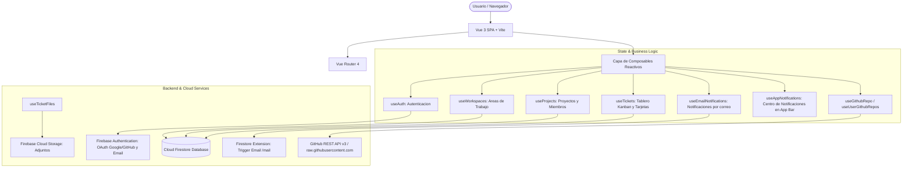

# Guia de Arquitectura y Manual Tecnico — Dev Flow

Documentacion tecnica integral sobre la arquitectura interna, modelo de datos, flujo reactivo, sistema de permisos y directrices de desarrollo para **Dev Flow**.

---

## 1. Arquitectura General del Sistema

Dev Flow esta disenada como una Single Page Application (SPA) con arquitectura desacoplada basada en componentes de Vue 3, composables reactivos y servicios en la nube de Google Firebase.



---

## 2. Modelo de Areas de Trabajo y Colaboracion

Dev Flow implementa un modelo jerarquico de tres niveles:

```text
Usuario (Auth UID)
 └── Area de Trabajo (Workspace) [Maximo 5 por usuario]
      └── Proyecto (Project) [Maximo 20 por area]
           └── Tickets (Kanban Cards)
                ├── Comentarios (Subcoleccion)
                ├── Archivos Adjuntos (Firebase Storage)
                └── Historial de Actividad (Subcoleccion)
```

### Reglas de Areas de Trabajo:
1. **Limite de Capacidad**: Cada usuario puede crear hasta un maximo de 5 areas de trabajo independientes.
2. **Limite de Proyectos**: Cada area de trabajo admite hasta un maximo de 20 proyectos (`MAX_PROJECTS_PER_WORKSPACE = 20`).
3. **Membresias Compartidas (Invitados)**:
   - Cuando un usuario es invitado a uno o varios proyectos de otra persona (mediante enlace o correo electronico), **no se le solicita crear un area de trabajo**.
   - El sistema vincula automaticamente el area de trabajo del anfitrion como un **Area Compartida** (`sharedWorkspaces`).
   - En el menu lateral y selectores, se indica con la etiqueta destacada `Invitado`.
   - El invitado **no puede crear proyectos ni eliminarlos** en el area del anfitrion.
   - El invitado solo tiene acceso de colaboracion en los proyectos que le fueron expresamente asignados.

---

## 3. Matriz de Permisos y Roles

| Accion | Propietario del Area | Miembro Invitado |
| :--- | :---: | :---: |
| Crear / Eliminar Area de Trabajo | Si | No |
| Abrir Ajustes del Area e Invitar | Si | No |
| Crear / Eliminar Proyectos | Si | No |
| Asignar / Quitar Proyectos a Miembros | Si | No |
| Copiar Enlace de Invitacion a Proyecto | Si | No |
| Invitar Colegas por Correo | Si | No |
| Crear / Editar / Mover Tickets | Si | Si |
| Asignar Responsable a Tickets | Si | Si |
| Comentar y Subir Adjuntos en Tickets | Si | Si |
| Consultar Documentacion y README | Si | Si |

---

## 4. Esquema de Base de Datos (Cloud Firestore)

### Coleccion: `workspaces`
Almacena las areas de trabajo creadas por los usuarios.
```typescript
interface WorkspaceDoc {
  name: string            // Nombre visible del area
  userId: string          // UID del propietario creador
  createdAt: Timestamp    // Fecha de creacion del servidor
}
```

### Coleccion: `projects`
Almacena los proyectos asignados a cada area de trabajo.
```typescript
interface ProjectDoc {
  name: string            // Nombre del proyecto
  description: string     // Descripcion del proyecto
  type: 'backend' | 'frontend' | 'mobile' | 'web' | 'fullstack'
  userId: string          // UID del creador/propietario
  workspaceId: string     // ID del workspace al que pertenece
  createdAt: Timestamp    // Fecha de creacion
  tech?: string           // Tecnologias y herramientas
  connections?: string    // Conexiones e integraciones
  server?: string         // Servidores / Infraestructura
  doc?: string            // Enlace o notas de documentacion
  github?: string         // URL del repositorio en GitHub
  members: Array<{
    uid: string           // UID del usuario o 'pending_correo'
    email: string         // Correo del miembro
    displayName: string   // Nombre visible
    role: 'owner' | 'member'
    joinedAt: number      // Timestamp de incorporacion
  }>
  memberUids: string[]    // Array indexado para consultas array-contains
}
```

### Coleccion: `tickets`
Almacena los tickets del tablero Kanban con soporte para dependencias y subtickets.
```typescript
interface TicketDoc {
  projectId: string       // ID del proyecto al que pertenece
  title: string           // Titulo de la tarea
  description: string     // Descripcion detallada
  priority: 'urgent' | 'high' | 'medium' | 'low'
  status: 'sin-realizar' | 'en-proceso' | 'testing' | 'completado'
  startDate: Timestamp | null
  endDate: Timestamp | null
  userId: string          // UID del autor del ticket
  createdBy: string       // Nombre del creador
  createdByEmail: string  // Correo del creador
  assignedTo: string | null     // UID del miembro asignado
  assignedToEmail: string | null// Correo del asignado
  parentId: string | null       // ID del ticket padre (si es subticket)
  linkedTickets: Array<{
    ticketId: string
    type: 'blocks' | 'depends_on' | 'related_to'
  }>
  createdAt: Timestamp
  completedAt: Timestamp | null
  closedAt: Timestamp | null
  hasStarted: boolean
}
```

### Subcolecciones de `tickets`:
- `tickets/{id}/comments/{commentId}`: Hilos de discusion en tiempo real.
- `tickets/{id}/files/{fileId}`: Metadatos de archivos adjuntos respaldados en Storage.
- `tickets/{id}/activity/{activityId}`: Historial de transiciones y cambios en el ticket.

### Coleccion: `mail`
Coleccion procesada por la extension **Trigger Email** de Firebase.
```typescript
interface MailDoc {
  to: string[]            // Destinatarios
  message: {
    subject: string       // Asunto del correo
    html: string          // Plantilla HTML renderizada
  }
}
```

---

## 5. Reglas de Seguridad (`firestore.rules`)

El archivo `firestore.rules` protege la integridad de los datos garantizando que:
1. `workspaces`: Solo el propietario puede crear, editar o eliminar su espacio de trabajo. Usuarios autenticados pueden leer nombres para mostrar areas compartidas.
2. `projects`: Solo el propietario puede eliminar o editar la configuracion estructural del proyecto. Los miembros pueden auto-vincularse mediante enlace actualizando unicamente los campos `members` y `memberUids`.
3. `tickets`: Los miembros y propietarios del proyecto pueden consultar, crear y mover tickets.
4. `subcolecciones`: Lectura y escritura restringida a usuarios autenticados autorizados en el proyecto.

---

## 6. Modulos Principales (Composables)

### `useWorkspaces`
- **`workspaces`**: Lista reactiva de areas propias.
- **`sharedWorkspaces`**: Lista reactiva de areas compartidas donde participa el usuario.
- **`currentWorkspace`**: Area de trabajo actualmente activa.
- **`createWorkspace(name)`**: Valida y crea un nuevo espacio propio (maximo 5).
- **`setCurrentWorkspace(ws)`**: Selecciona el espacio y lo persiste en `localStorage`.

### `useProjects`
- **`projects`**: Proyectos filtrados por el area de trabajo activa.
- **`allProjects`**: Lista consolidada reactiva de todos los proyectos accesibles.
- **`createProject(name, desc, type, extra)`**: Crea proyecto en el area activa (maximo 20).
- **`loadAndJoinProject(projectId)`**: Carga el proyecto y une al usuario como miembro automaticamente si accede por enlace de invitacion.
- **`addMember` / `removeMember`**: Administra la lista de colaboradores por proyecto.

### `useTickets`
- **`tickets`**: Coleccion de tickets activos.
- **`watchProjectTickets(projectId)`**: Escucha en tiempo real todos los tickets del proyecto seleccionado para colaboracion multiusuario.
- **`createTicket` / `updateTicketStatus` / `updateTicket` / `deleteTicket`**: Operaciones sobre tarjetas del tablero.
- **`linkTicket` / `unlinkTicket`**: Gestion de dependencias (`blocks`, `depends_on`, `related_to`).

### `useEmailNotifications`
- **`sendTicketCreated`**: Notificacion al crear ticket con descripcion detallada.
- **`sendTicketMoved`**: Notificacion al cambiar estado de ticket.
- **`sendInviteEmail`**: Invitacion a proyecto sin obligar a crear area.
- **`sendProjectAddedEmail`**: Notificacion al asignar un proyecto adicional a un miembro.
- **`sendProjectRemovedEmail`**: Notificacion al revocar acceso a un proyecto.
- **`sendWorkspaceRemovedEmail`**: Notificacion al desvincular de un area de trabajo.

### `useGithubRepo`
- Inspeccion de repositorios de GitHub con token OAuth scoped por usuario (`dev-flow-github-token_${uid}`).
- Carga de README.md con fallback automatico a `raw.githubusercontent.com`.
- Consulta en vivo de los ultimos 30 commits y Pull Requests del repositorio.
- Generacion automatica de comandos de commit (`git commit -m "fix: ... (close #ID)"`) y ramas (`git checkout -b feature/...`).
- Sincronizacion inteligente: auto-completa tickets cuando se detectan palabras clave (`close`, `fix`, `done`) en commits de `main` o ramas, y cuando se fusionan Pull Requests.

---

## 7. Integracion Git & GitHub (VS Code y Terminal)

Dev Flow soporta dos flujos de trabajo en simultaneo:

1. **Flujo Directo en `main`**:
   - Cada tarjeta provee un comando de commit copiable en 1 clic:
     ```bash
     git commit -m "fix: modal centrado (close #a1b2c3)"
     ```
   - Al pulsar el boton **"Sincronizar Git"** en el tablero (o desde el inspector), Dev Flow escanea los commits de `main`. Si detecta `close`, `fix` o el ID/slug del ticket, mueve la tarjeta a **Completado**, adjunta el hash del commit (`sha`) y registra la actividad con enlace a GitHub.
   - Tambien permite asociar manualmente cualquier commit reciente de `main` con un selector desplegable.

2. **Flujo con Ramas y Pull Requests (Colaboradores)**:
   - Boton rapido **"Copiar rama Git"** en el menu flotante de la tarjeta o en el panel inspector:
     ```bash
     git checkout -b feature/nombre-del-ticket
     ```
   - Al fusionar el Pull Request en GitHub, Dev Flow detecta el PR cerrado/mergeado y completa el ticket automaticamente.

3. **Automatizacion con Git Hook (`prepare-commit-msg`)**:
   - Permite que cualquier commit realizado desde VS Code o la terminal inyecte automaticamente `[fixes DF-X]` segun la rama activa (`feature/DF-X-...`).
   - Se instala en 1 clic ejecutando:
     ```bash
     # Mac / Linux / Git Bash
     curl -fsSL https://dev-flow-7b197.web.app/hooks/prepare-commit-msg -o .git/hooks/prepare-commit-msg && chmod +x .git/hooks/prepare-commit-msg
     ```
     ```powershell
     # Windows (PowerShell)
     Invoke-WebRequest -Uri "https://dev-flow-7b197.web.app/hooks/prepare-commit-msg" -OutFile ".git/hooks/prepare-commit-msg"
     ```
   - Al hacer `git push`, Dev Flow completa el ticket automaticamente.

---

## 8. Despliegue en Produccion

El proyecto se encuentra configurado para compilacion estatica con Vite y despliegue en Firebase Hosting:

```bash
# Compilacion y chequeo de tipos TypeScript
npm run build

# Despliegue en Firebase (Hosting y Reglas de Firestore)
firebase deploy --only "hosting,firestore:rules"
```
